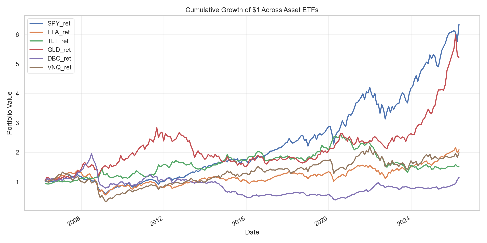
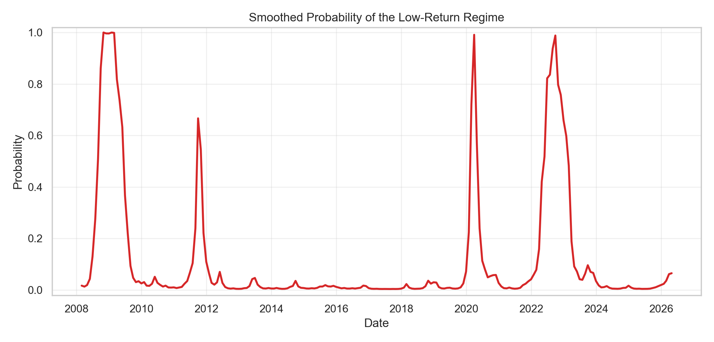
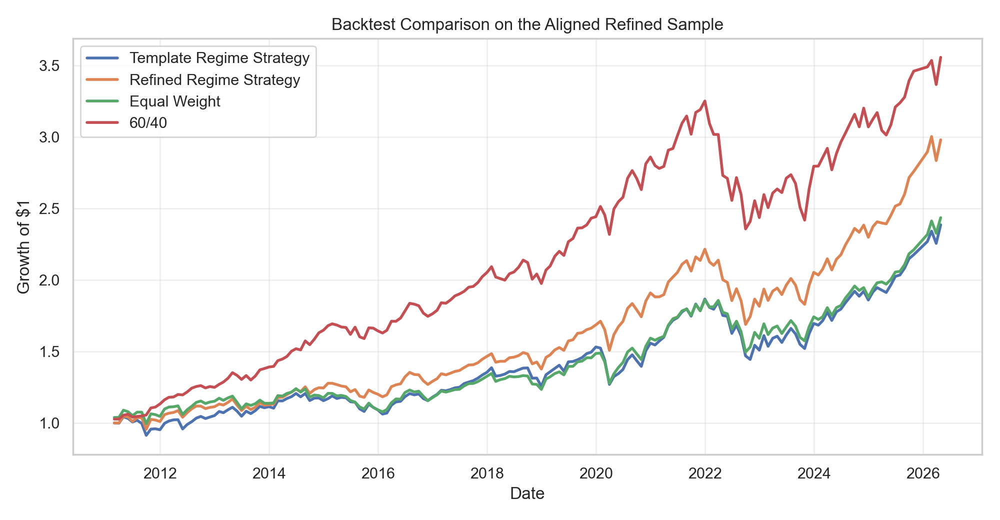
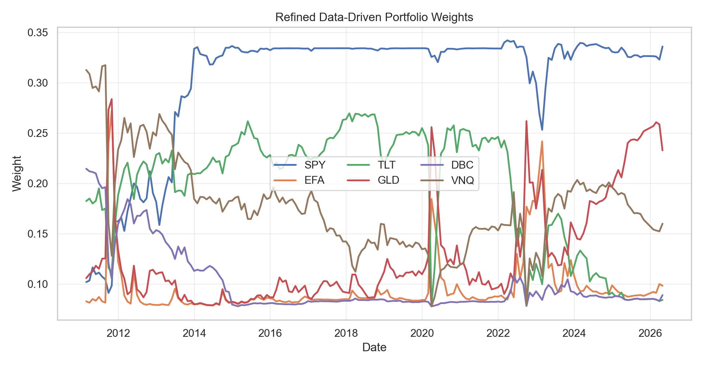

# Bayesian Regime Inference for Macro-Driven Asset Allocation

## Team Members

- Bosen Yang
- Jingnan Chi
- Kevin Long
- Mike Peng

This project studies whether latent market regimes can help explain asset behavior
and improve dynamic portfolio allocation across a diversified ETF universe.

The work was completed for a Bayesian Machine Learning course and combines:

- macroeconomic indicators
- cross-asset ETF returns
- Bayesian regime modeling
- dynamic regime-switching models
- regime-aware portfolio backtesting

## Project Question

Can latent market regimes inferred from macro and return data improve portfolio
allocation relative to simple benchmark portfolios?

## Assets and Signals

### Asset universe

- `SPY`: US equities
- `EFA`: developed international equities
- `TLT`: long-duration US Treasuries
- `GLD`: gold
- `DBC`: broad commodities
- `VNQ`: US REITs

### Macro signals

- yield curve slope: `T10Y2Y`
- equity volatility: `VIX`
- credit spread: `CREDIT`
- unemployment level: `UNRATE`
- unemployment change: `UNRATE_CHG`
- industrial production growth: `INDPRO_YOY`
- Chicago Fed National Activity Index: `CFNAI`

## Repo Structure

- [Data Collection.ipynb](/Users/bosen/Desktop/ADSP%2032014%20Bayesian%20Machine%20Learning/final%20project/Data%20Collection.ipynb:1)
  Builds the raw and model-ready datasets from FRED and Yahoo Finance.
- [01_Project_Roadmap_and_EDA.ipynb](/Users/bosen/Desktop/ADSP%2032014%20Bayesian%20Machine%20Learning/final%20project/01_Project_Roadmap_and_EDA.ipynb:1)
  Main analysis notebook. Includes EDA, regime models, allocation logic, and
  backtests.
- [macro_asset_raw.csv](/Users/bosen/Desktop/ADSP%2032014%20Bayesian%20Machine%20Learning/final%20project/macro_asset_raw.csv:1)
  Raw monthly asset prices, macro features, and asset returns.
- [macro_asset_dataset.csv](/Users/bosen/Desktop/ADSP%2032014%20Bayesian%20Machine%20Learning/final%20project/macro_asset_dataset.csv:1)
  Original model dataset with full-sample standardized macro variables.
- [macro_asset_dataset_expanding_z.csv](/Users/bosen/Desktop/ADSP%2032014%20Bayesian%20Machine%20Learning/final%20project/macro_asset_dataset_expanding_z.csv:1)
  Backtest-safe dataset using expanding-window macro standardization.
- [baseline_regime_results.csv](/Users/bosen/Desktop/ADSP%2032014%20Bayesian%20Machine%20Learning/final%20project/baseline_regime_results.csv:1)
  Baseline Gaussian mixture regime classification output.
- [bayesian_hmm_results.csv](/Users/bosen/Desktop/ADSP%2032014%20Bayesian%20Machine%20Learning/final%20project/bayesian_hmm_results.csv:1)
  Bayesian 2-state HMM output.
- [markov_switching_results.csv](/Users/bosen/Desktop/ADSP%2032014%20Bayesian%20Machine%20Learning/final%20project/markov_switching_results.csv:1)
  Preferred dynamic regime model output.
- [regime_backtest_results.csv](/Users/bosen/Desktop/ADSP%2032014%20Bayesian%20Machine%20Learning/final%20project/regime_backtest_results.csv:1)
  First regime-aware template backtest.
- [refined_regime_backtest_results.csv](/Users/bosen/Desktop/ADSP%2032014%20Bayesian%20Machine%20Learning/final%20project/refined_regime_backtest_results.csv:1)
  Refined data-driven regime-aware backtest.
- [outputs](/Users/bosen/Desktop/ADSP%2032014%20Bayesian%20Machine%20Learning/final%20project/outputs)
  Saved EDA figures and summary tables.

## Workflow

### 1. Data construction

The project begins with monthly asset returns and macro indicators aligned to a
common calendar. A one-month publication lag is applied to macro variables to
avoid unrealistic timing assumptions.

### 2. Exploratory analysis

The EDA shows:

- strong co-movement among risky assets
- changing volatility through time
- macro conditions that line up with recognizable stress periods

Some notable patterns:

- `SPY` and `EFA` return correlation is about `0.872`
- `SPY` and `VNQ` return correlation is about `0.752`
- `SPY` and `GLD` are the strongest long-run performers in the sample

These patterns support using a regime model rather than a single-factor linear
forecasting rule.

### 3. Backtest-safe preprocessing

The notebook rebuilds macro standardization using an expanding window rather
than full-sample `z`-scores. This avoids look-ahead bias in later regime and
backtest sections.

The backtest-safe sample used for the final modeling steps has:

- `217` monthly observations
- date range: `2008-02-29` to `2026-04-30`

## Models

### Baseline model: Gaussian mixture

The first benchmark is a Gaussian mixture model on the six asset return series.
It does not model regime persistence directly, but it gives a simple first-pass
regime classification.

Key baseline result:

- the low-return regime covers `17` months, about `7.8%` of the sample
- average equal-weight monthly return in that regime is about `-4.65%`

### Bayesian model: 2-state Hidden Markov Model

To keep the project aligned with the Bayesian ML course theme, the notebook
includes a Bayesian 2-state HMM on the equal-weight portfolio return.

Key Bayesian findings:

- low-return regime posterior mean return: about `-1.71%` per month
- high-return regime posterior mean return: about `0.81%` per month
- low-return regime posterior volatility: about `5.83%`
- high-return regime posterior volatility: about `2.70%`
- posterior transition matrix is persistent, with diagonals about `0.825` and `0.952`

This section provides the Bayesian core of the project.

### Preferred dynamic model: Markov-switching regression

The main empirical regime model is a 2-state Markov-switching regression on the
equal-weight portfolio return. This model is easier to interpret, stable in the
current environment, and well suited to allocation decisions.

Key Markov-switching findings:

- low-return regime mean: about `-1.84%` per month
- low-return regime volatility: about `6.68%`
- high-return regime mean: about `0.78%` per month
- high-return regime volatility: about `2.58%`
- expected low-regime duration: about `5.15` months
- expected high-regime duration: about `38.73` months

The low-return regime also lines up with worse macro conditions:

- `VIX_z_exp` about `1.486`
- `CREDIT_z_exp` about `1.098`
- `UNRATE_z_exp` about `0.734`
- `INDPRO_YOY_z_exp` about `-1.212`
- `CFNAI_z_exp` about `-1.144`

## Allocation and Backtesting

### First allocation layer

The first regime-aware strategy uses filtered Markov-switching probabilities to
blend between a hand-crafted risk-on and risk-off portfolio.

Template strategy results:

- annualized return: `5.93%`
- annualized volatility: `10.56%`
- Sharpe ratio: `0.5618`
- max drawdown: `-22.63%`
- average monthly turnover: `0.0506`

### Refined allocation layer

The refined strategy estimates regime-specific portfolios directly from the data
using:

- filtered regime probabilities
- expanding historical estimation
- long-only mean-variance style weights
- weight caps and floors
- a blend with equal-weight to reduce concentration

Refined strategy results:

- annualized return: `7.51%`
- annualized volatility: `10.36%`
- Sharpe ratio: `0.7243`
- max drawdown: `-23.74%`
- average monthly turnover: `0.0463`

### Benchmarks

Two benchmark portfolios are used:

- `equal_weight`: equal weight across all six ETFs
- `60/40`: `60%` `SPY` and `40%` `TLT`

Benchmark comparison on the aligned refined backtest sample:

- `equal_weight`: annualized return `6.08%`, Sharpe `0.6029`
- `60/40`: annualized return `8.78%`, Sharpe `0.8747`

## Main Findings

- Regime models identify economically meaningful market states.
- The Bayesian HMM supports the course objective by providing a true Bayesian
  latent-state model with posterior uncertainty.
- The Markov-switching model is the strongest main regime model for this
  dataset because it is stable, interpretable, and directly useful for
  allocation.
- Regime-aware allocation is useful, but the exact portfolio construction rule
  matters a lot.
- The refined data-driven strategy improves materially over the hand-built
  regime template.
- A simple `60/40` benchmark remains difficult to beat, which is an important
  and honest result.

## Final Conclusion

The project supports a balanced conclusion:

> Bayesian and regime-switching models can identify economically meaningful
> market states, and those states can improve dynamic allocation decisions, but
> the quality of the final portfolio depends heavily on how the regime signal is
> translated into weights.

This means the main contribution of the project is not just finding regimes. It
is showing that:

- market regimes are real and interpretable in the data
- Bayesian and switching models can recover them
- allocation benefits are possible, but not automatic

## How To Run

### Recommended order

1. Run [Data Collection.ipynb](/Users/bosen/Desktop/ADSP%2032014%20Bayesian%20Machine%20Learning/final%20project/Data%20Collection.ipynb:1) if you want to rebuild the datasets.
2. Run [01_Project_Roadmap_and_EDA.ipynb](/Users/bosen/Desktop/ADSP%2032014%20Bayesian%20Machine%20Learning/final%20project/01_Project_Roadmap_and_EDA.ipynb:1) from top to bottom.

### Main Python packages used

- `pandas`
- `numpy`
- `matplotlib`
- `seaborn`
- `scikit-learn`
- `scipy`
- `statsmodels`

## Notes

- The Bayesian HMM section is intentionally simpler than the Markov-switching
  section because the local environment did not include a full probabilistic
  programming stack such as PyMC.
- The Markov-switching model is frequentist, not Bayesian, but it is retained
  because it provides the most robust dynamic regime fit in this repo.
